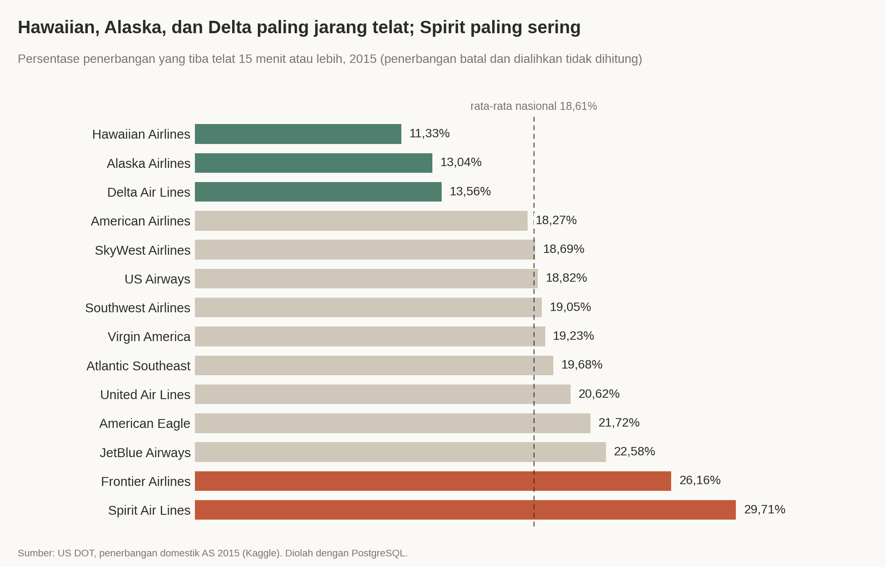
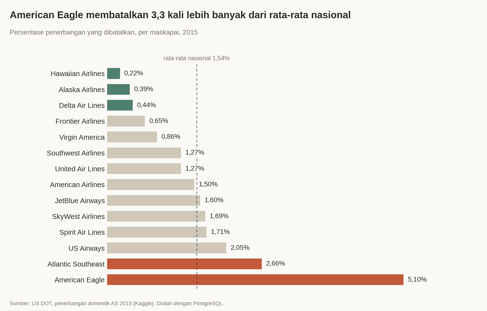
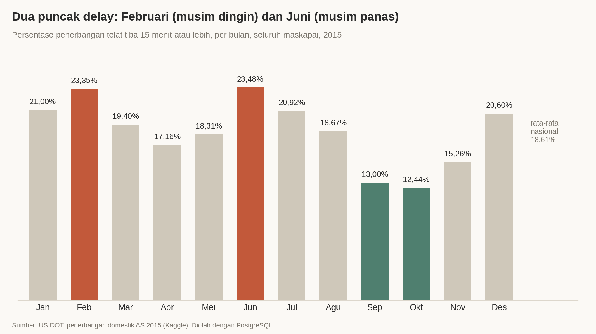
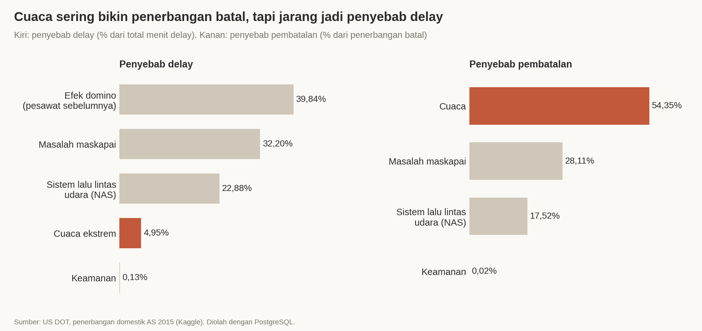
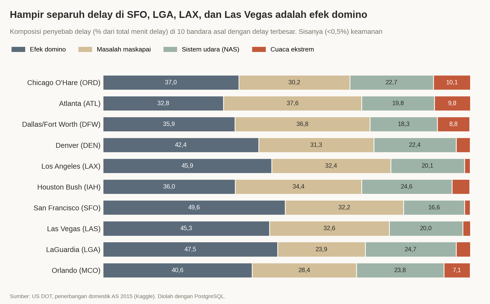

# Alaska, Delta, dan Hawaiian Paling Andal: Analisis SQL atas 5,8 Juta Penerbangan Domestik AS 2015

Dari 14 maskapai domestik di Amerika Serikat, mana yang paling jarang telat dan paling jarang membatalkan penerbangan? Kapan dan di bandara mana delay paling parah? Proyek ini menjawabnya dengan SQL (PostgreSQL) atas 5.819.079 penerbangan sepanjang 2015.

## Ringkasan

- Alaska, Delta, dan Hawaiian berada di bawah rata-rata nasional untuk delay maupun pembatalan. Sebaliknya, 29,71% penerbangan Spirit dan 26,16% penerbangan Frontier tiba telat 15 menit atau lebih.
- Penyebab delay terbesar adalah efek domino: pesawat yang datang telat dari penerbangan sebelumnya menyumbang 39,84% total menit delay. Cuaca ekstrem hanya 4,95% dari menit delay, tetapi menjadi penyebab 54,35% pembatalan.
- Juni (23,48% telat) dan Februari (23,35%) adalah bulan terburuk. September (13,00%) dan Oktober (12,44%) paling lancar.

## Business Problem

Analisis ini ditujukan untuk orang yang memilih maskapai dan jadwal terbang: travel manager perusahaan, tim operasional yang sering mengirim karyawan dinas, dan penumpang yang ingin tahu risiko delay sebelum memesan tiket.

Keputusan yang ingin dibantu:

- Maskapai mana yang sebaiknya dipilih (dan dihindari) kalau ketepatan waktu penting.
- Bulan dan bandara mana yang perlu diberi waktu cadangan lebih banyak atau dihindari untuk koneksi yang ketat.
- Apa penyebab delay yang paling dominan, sehingga bisa dibedakan risiko yang bisa dikurangi lewat pilihan maskapai dan yang tidak.

## Dataset

- Sumber: [2015 Flight Delays and Cancellations (US DOT) di Kaggle](https://www.kaggle.com/datasets/usdot/flight-delays)
- Ukuran:
  - `flights.csv`: 5.819.079 baris x 31 kolom
  - `airlines.csv`: 14 baris
  - `airports.csv`: 322 baris
- Periode: 1 Januari sampai 31 Desember 2015, penerbangan domestik AS

Catatan penting tentang data:

| Hal | Penjelasan |
|---|---|
| Definisi delay | Penerbangan dianggap telat jika tiba 15 menit atau lebih setelah jadwal (standar US DOT). Penerbangan yang dibatalkan dan dialihkan (diverted) tidak dihitung dalam analisis delay. Pembatalan dianalisis terpisah lewat cancellation rate. |
| Data Oktober | Seluruh 486.165 penerbangan bulan Oktober (8,4% dari total) memakai kode bandara numerik yang tidak ada pemetaannya di `airports.csv`, sehingga tidak bisa diterjemahkan ke nama bandara. Data ini tetap dipakai di analisis per maskapai dan per bulan, tetapi **tidak ikut** di analisis per bandara (Q5, Q7, Q12, Q13). Pengecekannya ada di `sql/02a_data_quality_check.sql`. |
| Data penyebab delay | Kolom penyebab hanya terisi untuk penerbangan yang telat tiba 15 menit atau lebih (1.063.439 penerbangan). Kolom `weather_delay` hanya mencatat cuaca ekstrem. Cuaca biasa seperti angin kencang atau jarak pandang rendah dicatat sebagai gangguan sistem lalu lintas udara (NAS). |
| File CSV | Sekitar 565 MB, tidak disertakan di repo karena melebihi batas ukuran GitHub. Unduh dari Kaggle (lihat Cara Menjalankan). |

## Tools

- PostgreSQL 17 dan pgAdmin 4 untuk database dan query
- SQL: JOIN, CTE, window function (`RANK`, `SUM() OVER`), `FILTER`, `CROSS JOIN LATERAL`
- Python (matplotlib) hanya untuk membuat chart dari hasil query

## Pendekatan

**1. Cleaning**

- Memuat CSV ke schema `staging` dengan semua kolom bertipe teks, supaya import tidak gagal karena data kotor.
- Membangun tiga tabel final (`airlines`, `airports`, `flights`) dengan tipe data yang benar: tanggal, angka, boolean, dan nilai kosong menjadi `NULL`.
- Memeriksa kualitas JOIN antartabel (di sinilah masalah kode bandara Oktober ditemukan), lalu menambah index untuk mempercepat query.

**2. Analisis**

| File | Isi |
|---|---|
| `01_create_staging.sql` | Membuat schema `staging` dan tabel mentah |
| `01b_import_data.sql` | Import ketiga CSV ke staging |
| `02a_data_quality_check.sql` | Cek kualitas data dan JOIN antartabel |
| `02_clean_and_build_schema.sql` | Membangun tabel final bertipe benar |
| `03_basic_queries.sql` | Ringkasan, delay per maskapai, cancellation rate, penyebab pembatalan |
| `04_advanced_queries.sql` | JOIN ke bandara, CTE perbandingan dengan rata-rata nasional, ranking bandara terburuk per bulan (`RANK`), ranking bulan |
| `05_delay_causes.sql` | Penyebab delay secara nasional, per bulan, per bandara, dan di bandara terburuk tiap bulan |

**3. Visualisasi**

Chart dibuat dengan `scripts/make_charts.py` memakai angka dari hasil query.

## Temuan Utama

**1. Skala masalahnya besar.** Dari 5.819.079 penerbangan, 89.884 (1,54%) dibatalkan. Di antara penerbangan yang tidak dibatalkan dan tidak dialihkan, 18,61% tiba telat 15 menit atau lebih (1.063.439 penerbangan). Rata-rata selisih jam tiba adalah 4,41 menit, dan total delay mencapai sekitar 62,65 juta menit.

**2. Alaska, Delta, dan Hawaiian paling andal.** Ketiganya di bawah rata-rata nasional untuk delay maupun pembatalan, sedangkan Spirit dan Frontier di atasnya:

| Maskapai | Rata-rata telat tiba (menit) | Telat 15+ menit | Cancel rate |
|---|---|---|---|
| Hawaiian | 2,02 | 11,33% | 0,22% |
| Alaska | -0,98 | 13,04% | 0,39% |
| Delta | 0,19 | 13,56% | 0,44% |
| Frontier | 12,50 | 26,16% | 0,65% |
| Spirit | 14,47 | 29,71% | 1,71% |
| Rata-rata nasional | 4,41 | 18,61% | 1,54% |

Angka negatif berarti rata-rata penerbangan tiba lebih awal dari jadwal.

**3. American Eagle paling sering membatalkan penerbangan:** 5,10%, atau 3,3 kali rata-rata nasional. Disusul Atlantic Southeast dengan 2,66%.

**4. Penyebab delay terbesar adalah efek domino,** yaitu pesawat yang datang telat dari penerbangan sebelumnya (39,84% dari total menit delay). Berikutnya masalah internal maskapai (32,20%) dan sistem lalu lintas udara (22,88%). Cuaca ekstrem hanya 4,95%.

**5. Cuaca lebih memengaruhi pembatalan daripada delay.** Cuaca menyebabkan 54,35% pembatalan, tetapi hanya 4,95% menit delay.

**6. Delay punya dua puncak musiman.** Juni (23,48%) dan Februari (23,35%) paling buruk, sedangkan Oktober (12,44%) dan September (13,00%) paling lancar.

**7. Bandara terburuk berganti sesuai musim.** Persentase telat berangkat tertinggi per bulan:

- Januari: Chicago O'Hare (31,96%)
- Februari: Chicago O'Hare (37,48%)
- Mei: Dallas Love Field (34,15%)
- Juni: Chicago Midway (34,60%)
- Juli: Baltimore-Washington (33,23%)
- Agustus: Miami (28,05%)

Di Februari, porsi cuaca di O'Hare naik menjadi 15,0% dari total menit delay, dibanding 10,1% rata-rata setahun.

**8. Sebagian besar maskapai mengejar waktu di udara.** United, misalnya, telat berangkat rata-rata 14,33 menit tetapi telat tiba hanya 5,43 menit. Spirit dan Frontier hampir tidak bisa mengejar: 15,88 menjadi 14,47 menit untuk Spirit, dan 13,30 menjadi 12,50 menit untuk Frontier.

## Rekomendasi Keputusan

1. **Pilih Alaska, Delta, atau Hawaiian** jika rutenya tersedia. Ketiganya berada di bawah rata-rata nasional untuk telat rata-rata, persentase telat, dan cancel rate. Delta paling teruji karena volumenya besar (870 ribu penerbangan dalam data).
2. **Beri waktu cadangan ekstra untuk Spirit dan Frontier.** Hampir 3 dari 10 penerbangan Spirit (29,71%) dan lebih dari 1 dari 4 penerbangan Frontier (26,16%) telat. Untuk American Eagle dan Atlantic Southeast, hindari koneksi yang ketat karena cancel rate-nya 5,10% dan 2,66%.
3. **Jika jadwal fleksibel, hindari Februari dan Juni;** September dan Oktober paling lancar. Selisihnya besar: 23,48% telat di Juni dibanding 12,44% di Oktober.
4. **Hindari koneksi pendek lewat bandara yang sedang di puncak masalahnya:** Chicago O'Hare dan Denver di Januari; O'Hare, LaGuardia (35,84%), dan Boston (32,48%) di Februari; Dallas Love Field di Mei; Chicago Midway di Juni; Baltimore-Washington di Juli; dan Miami di Agustus.
5. **Karena 39,84% menit delay berasal dari efek domino,** penerbangan lanjutan di hari yang sama dengan pesawat yang sama berisiko lebih tinggi. Pilih jadwal dengan jeda antarpenerbangan yang cukup.

## Screenshot / Demo











## Cara Menjalankan

Kebutuhan: PostgreSQL 15 atau lebih baru (dengan `psql`), dan Python 3 dengan `matplotlib` (hanya untuk chart).

1. Unduh dataset dari [Kaggle](https://www.kaggle.com/datasets/usdot/flight-delays), ekstrak, lalu taruh `airlines.csv`, `airports.csv`, dan `flights.csv` di folder `data/`.

2. Buat database:

   ```
   psql -U postgres -c "CREATE DATABASE flight_delays;"
   ```

3. Jalankan file SQL secara berurutan dari folder utama proyek:

   ```
   psql -U postgres -d flight_delays -f sql/01_create_staging.sql
   psql -U postgres -d flight_delays -f sql/01b_import_data.sql
   psql -U postgres -d flight_delays -f sql/02a_data_quality_check.sql
   psql -U postgres -d flight_delays -f sql/02_clean_and_build_schema.sql
   psql -U postgres -d flight_delays -f sql/03_basic_queries.sql
   psql -U postgres -d flight_delays -f sql/04_advanced_queries.sql
   psql -U postgres -d flight_delays -f sql/05_delay_causes.sql
   ```

   Import `flights.csv` memakan waktu beberapa menit. Query 03 sampai 05 juga bisa dijalankan satu per satu di pgAdmin Query Tool. Jika `psql` tidak dikenali di Windows, jalankan file lewat PSQL Tool di pgAdmin. Jika import gagal karena file tidak ditemukan, sesuaikan path CSV di `sql/01b_import_data.sql` dengan lokasi file di komputer Anda.

4. (Opsional) Buat ulang chart:

   ```
   pip install matplotlib
   python scripts/make_charts.py
   ```

Struktur folder:

```
flight-delays-sql/
├── README.md
├── .gitignore
├── data/            tempat CSV (tidak ikut repo)
├── sql/             7 file SQL berurutan
├── images/          5 chart untuk README
└── scripts/         make_charts.py
```

## Keterbatasan & Next Steps

Keterbatasan:

- Data hanya satu tahun (2015), jadi pola musiman belum teruji di tahun lain.
- Perbandingan antarmaskapai belum mengontrol jaringan rute, jarak terbang, dan bandara yang dilayani. Hasilnya berarti "paling andal di data 2015 dengan jaringan rutenya masing-masing", bukan "paling baik secara mutlak".
- Maskapai dengan volume kecil (Hawaiian sekitar 76 ribu dan Virgin America sekitar 61 ribu penerbangan) punya estimasi yang kurang stabil dibanding maskapai besar.
- Oktober tidak tercakup di analisis per bandara karena kode bandara numerik tidak bisa dipetakan.
- Analisis per bandara memakai bandara asal. Penyebab delay dicatat untuk keterlambatan tiba, jadi efek domino bisa berasal dari bandara lain.
- Penjelasan musiman (misalnya cuaca di musim dingin) adalah pola yang terlihat di data, bukan bukti sebab-akibat. Tidak ada uji signifikansi statistik.

Next steps:

- Mencari tabel pemetaan kode bandara numerik (ID bandara US DOT) untuk melengkapi data Oktober.
- Menganalisis delay per jam keberangkatan dan hari dalam seminggu (kolom `scheduled_departure` dan `day_of_week` sudah ada di tabel).
- Menganalisis per rute (asal-tujuan) untuk membandingkan maskapai di rute yang sama.
- Membuat dashboard interaktif (Power BI, Tableau, atau Metabase) di atas database ini.

---

Dibuat oleh Daffa ([@Daffa-arynd](https://github.com/Daffa-arynd)). Proyek SQL lainnya: [epa-air-quality-sql](https://github.com/Daffa-arynd/epa-air-quality-sql).
